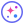
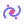
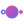
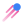

# Nebula glossary

*Version française [plus bas](#français).*

The common vocabulary of the framework, the reference for naming the code, the documentation and the interface.
Nebula and Univers are in use, the class of the latter spelled `Universe`: for the other terms, the last column gives the name the code and the documentation use today.

Each term has its icon, in the colors of the theme of NebulaStudio: the logo for Nebula, and for the others an SVG of
`NebulaStudio/resources/icons/`, which NebulaStudio shows where it deals with what the term names.

| Term    | Icon | Definition | Today |
| ------- | ---- | ---------- | ----- |
| Nebula  |  | The framework | In use: the name of the project, of its namespace, macros and package, formerly AppForge |
| Univers |  | The global scene, the root container of the application | In use: `Universe`, the application assembled from instances, formerly `ForgeApplication`, shown in the edition zone of NebulaStudio (`EditionScene`); its icon is the one of **New** |
| Galaxy  |  | A group of components | A colored zone of the edition zone (`ZoneItem`), known to NebulaStudio only: an application runs without them; its icon is the one of **Add zone** |
| Astre   |  | A component, with no hierarchy: no Astre is the parent or the child of another | An instance of a component (`Component`), named in its application (`Greeter1`); its icon is the one of the components in their list |
| Comet   |  | A configuration component, loaded at startup | A settings file (`SettingsFile`), read by `Universe::start()` before the first component starts; its icon is the one of **Add settings file**, **Edit settings file...** and of its dialog |

The Astres of an Univers are side by side: they are tied to one another only by the bindings of their interfaces, a
Galaxy groups them without owning them, and a Comet holds properties of some of them.

The glossary does not rename the other notions: plugin, interface, binding, property, project, and NebulaStudio, the editor.

---

## Français

Le vocabulaire commun du framework, la référence pour nommer le code, la documentation et l'interface. Le code et la
documentation emploient Nebula et Univers, la classe de ce dernier s'écrivant `Universe` : pour les autres termes, la dernière colonne donne le nom qu'ils y portent aujourd'hui.

Chaque terme a son icône, aux couleurs du thème de NebulaStudio : le logo pour Nebula, et pour les autres un SVG de
`NebulaStudio/resources/icons/`, que NebulaStudio montre là où il traite de ce que le terme nomme.

| Terme   | Icône | Définition | Aujourd'hui |
| ------- | ----- | ---------- | ----------- |
| Nebula  |  | Le framework | Employé : le nom du projet, de son espace de noms, de ses macros et de son paquet, auparavant AppForge |
| Univers |  | La scène globale, conteneur racine de l'application | Employé : `Universe`, l'application assemblée à partir d'instances, auparavant `ForgeApplication`, montrée dans la zone d'édition de NebulaStudio (`EditionScene`) ; son icône est celle de **New** |
| Galaxy  |  | Un regroupement de composants | Une zone colorée de la zone d'édition (`ZoneItem`), connue de NebulaStudio seulement : une application tourne sans elles ; son icône est celle de **Add zone** |
| Astre   |  | Un composant, sans hiérarchie : aucun Astre n'est le parent ni l'enfant d'un autre | Une instance d'un composant (`Component`), nommée dans son application (`Greeter1`) ; son icône est celle des composants dans leur liste |
| Comet   |  | Composant de configuration chargé au démarrage | Un fichier de réglages (`SettingsFile`), lu par `Universe::start()` avant que le premier composant démarre ; son icône est celle de **Add settings file**, **Edit settings file...** et de sa fenêtre |

Les Astres d'un Univers sont côte à côte : ils ne sont liés entre eux que par les liens de leurs interfaces, une Galaxy
les regroupe sans les posséder, et une Comet tient des propriétés de certains d'entre eux.

Le glossaire ne renomme pas les autres notions : plugin, interface, lien, propriété, projet, et NebulaStudio, l'éditeur.
